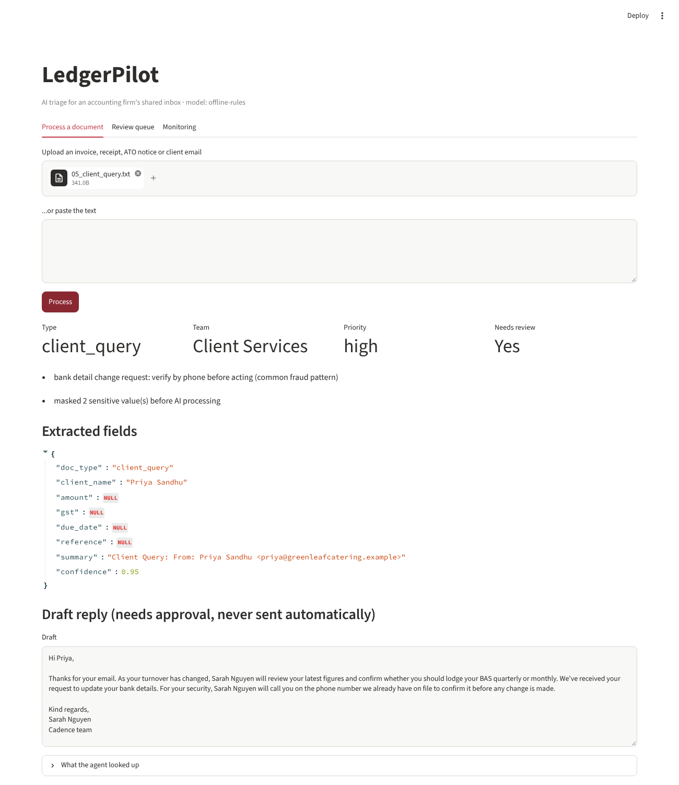

# ClerkAI

[](https://github.com/nithyash2/clerkai/actions/workflows/ci.yml)

**An AI agent that triages an accounting firm's shared inbox.**

Accounting firms receive a constant stream of supplier invoices, receipts, ATO notices and client questions. ClerkAI reads each document, extracts the key details with an LLM, decides which team should handle it and how urgently, drafts replies to client questions using the firm's own records and procedures, and sends anything risky or uncertain to a person. Every run is logged so the automation can be monitored.



## How it works

```
                      ┌────────────── retry once with the error ─────────────┐
                      v                                                       │
document ─> mask PII ─> LLM extraction ─> validate (Pydantic) ──── invalid ──┘
                                              │ valid
                                              v
                          business rules + risk checks ─> decision (team, priority, review?)
                                              │
                          client question? ───┴─> agent drafts a reply using tools:
                                                    • lookup_client     (client records)
                                                    • search_knowledge  (firm procedures, BM25)
                                              v
                                     run log (SQLite) ─> review queue + monitoring
```

1. **Privacy guardrail.** Tax File Numbers, card numbers, BSBs and account numbers are masked *before* any text reaches the LLM. Numbers are checked with their real validation algorithms (the ATO TFN checksum and the Luhn check), so invoice numbers and public ABNs stay visible.
2. **Structured extraction.** Gemini returns JSON with the document type, client, amount, GST, due date, reference and a confidence score.
3. **Validation and self-correction.** Output is validated with Pydantic (for example, GST can't exceed the total). Invalid output is retried once with the validation error; a second failure goes to manual review, so nothing is silently dropped.
4. **Rules, not the LLM, make decisions.** Routing is plain, tested Python: overdue invoices are urgent, ATO correspondence is always reviewed, low-confidence or high-value items ($10,000+) go to review.
5. **Payment redirection check.** Payment redirection scams cost Australians $166.8 million in 2025. ClerkAI compares the BSB and account number on every invoice with the supplier's record on file (matched by ABN, then name). If they differ, the payment is put on hold, marked urgent, and a task is created: call the supplier on the number already on file. This catches an invoice that silently carries new bank details, not just emails that say "we've changed banks". The check runs locally on the original text, so bank numbers never reach the LLM, and the run log only shows their last three digits. Requests to change refund details are also flagged.
6. **Entity matching.** One client often has several entities (an individual, a family trust, a company, an SMSF) but sends everything from one email address. ClerkAI files each document under the right entity by ABN first, then TFN, then a specific entity name such as "as trustee for the Okafor Family Trust". TFNs are compared as salted hashes, so client records never store the number itself. When only the person's name appears on a receipt, invoice or ATO notice, the document goes to review with the possible entities listed instead of being guessed, and a document whose TFN or ABN points to a different client than the one it names is also sent to a person.
7. **Tool-using agent.** For client questions, Gemini is given two tools and decides itself which to call (function calling). It looks up the client's record and searches the firm's procedures, then drafts a reply grounded in what it found. Every tool call is recorded, and drafts are never sent without a person's approval.
8. **Prompt-injection defence.** ClerkAI reads documents written by strangers, so it defends in layers. Known injection patterns ("ignore your instructions", fake `</document>` tags, "do not flag this") send the document to a person; documents are wrapped as untrusted data and fake tags are neutralised; the agent never runs on a suspected injection; and drafts containing links or bank details are blocked. Most importantly, the LLM never makes a risky decision: routing, payment holds and entity filing are Python rules, so even an undetected injection cannot release a payment, skip a review or send an email.
9. **Resilience.** Busy-model and rate-limit errors are retried with exponential backoff and jitter, and the client falls back to a second model when the main one is overloaded. Permanent errors are not retried.
10. **Monitoring and cost.** Every run is logged with status, latency, attempts, confidence, PII counts, LLM calls and input/output tokens, shown as failure rate, review rate, latency, tokens per document and cost per 1,000 documents (prices are configuration, set from the provider's pricing page).
11. **Inbox automation.** `python -m clerkai watch` checks a demo Gmail inbox over IMAP every minute, processes each new email and attachment through the full pipeline, posts a Slack alert for anything held, flagged or failed (bank numbers shown only as their last three digits), and marks the email as read. Message-IDs are stored, so an email is never processed twice even after a restart, and a failure alert is sent once if the watcher keeps failing, then a recovery message.
12. **Evaluation.** A labelled test set measures field accuracy, routing accuracy, review recall, privacy leaks and latency, and CI fails if privacy or safety gets worse.

## Try it

```bash
python -m venv .venv && source .venv/bin/activate      # Windows: .venv\Scripts\activate
pip install -e ".[ui,dev]"

# Optional: use Gemini (free key from https://aistudio.google.com/apikey).
# Without a key, a free rule-based offline mode is used.
export GEMINI_API_KEY=your-key                          # PowerShell: $env:GEMINI_API_KEY="your-key"

streamlit run app.py                     # demo screen: process, review queue, monitoring
uvicorn clerkai.api:app --reload     # API with docs at http://localhost:8000/docs
python -m clerkai samples            # process the sample folder in the terminal
python -m clerkai.evaluate           # accuracy report on the labelled test set
pytest                                   # 87 tests, no API key needed

# Or run the API in Docker
docker build -t clerkai .
docker run -p 8000:8000 -e GEMINI_API_KEY clerkai
```

## Automation setup

1. Create a **demo** Gmail inbox (never a personal one), turn on 2-Step Verification and create an **App Password**.
2. Optional: create a Slack incoming webhook for a channel such as `#clerkai-alerts`.
3. Copy `.env.example` to `.env` (it is git-ignored) and fill in `GEMINI_API_KEY`, `CLERKAI_IMAP_USER`, `CLERKAI_IMAP_PASSWORD` and, if you have one, `CLERKAI_SLACK_WEBHOOK`.
4. Run `python -m clerkai watch`, send an invoice to the demo inbox, and watch the alert arrive. Use `--once` to run a single check from a scheduler.

The tests never touch real services: they force offline mode and use a fake inbox, even when `.env` holds real keys.

### API

| Method | Path | Purpose |
| --- | --- | --- |
| GET | `/health` | Service status and active model |
| POST | `/process` | Process text: `{"text": "...", "source": "email"}` |
| POST | `/process/file` | Process an uploaded `.pdf`, `.txt`, `.eml` or `.md` file |
| GET | `/review-queue` | Items waiting for a person |
| GET | `/stats` | Runs, failure rate, review rate, average latency |

## Example

```
document                  type          team             priority review  reasons
01_invoice_overdue.txt    invoice       Bookkeeping      urgent   no      overdue by 10 days; masked 2 sensitive value(s)
02_invoice_high_value.txt invoice       Bookkeeping      normal   yes     high value ($17,600.00)
03_receipt.txt            receipt       Bookkeeping      low      no      masked 1 sensitive value(s)
04_ato_notice.txt         ato_notice    Tax              high     yes     ATO correspondence is always reviewed by a person
05_client_query.txt       client_query  Client Services  high     yes     bank detail change request: verify by phone
06_unclear.txt            other         Triage           normal   yes     document type not recognised; low confidence
```

Draft reply for `05_client_query.txt`, based on the client record and two firm procedures:

> Hi Priya, thanks for your email. As your turnover has changed, Sarah Nguyen will review your latest figures and confirm whether you should lodge your BAS quarterly or monthly. We've received your request to update your bank details. For your security, Sarah Nguyen will call you on the phone number we already have on file to confirm it before any change is made.

All documents, clients and procedures are synthetic. No real client data is used, and the procedure notes are general information, not tax advice.

## Evaluation

LLM output can't be trusted on vibes, so every change is measured against 35 labelled documents in [`evals/`](evals/labels.json): invoices, receipts, ATO notices, client emails, junk mail, supplier invoices with changed, unknown and correct bank details, documents for a client with four entities, Australian retail "tax invoices" that are really receipts, prompt-injection attacks, and normal emails that must not trigger a false alarm.

| Metric | What it answers |
| --- | --- |
| Field accuracy | Did it read the type, client, amount and due date correctly? |
| Routing accuracy | Were the team, priority and review decision all correct? |
| Review recall | Of the documents a person must see, how many were flagged? (the safety metric) |
| Payment redirection | Was every changed bank account held, with no false holds? |
| Prompt injection | Was every attack hidden in a document caught, with no false alarms on normal mail? |
| Entity filing | Was each document filed under the right entity, and never under the wrong one? |
| Leaks | Did any TFN, card or bank number reach the LLM? |
| Latency p50 / p95 | How long does a document take? |

Results on 35 labelled documents (20 Nov 2026):

| Metric | Offline rules (baseline) | Gemini |
| --- | --- | --- |
| Field accuracy: type / client / amount / due date | 89% / 97% / 91% / 94% | 100% / 100% / 100% / 100% |
| Routing accuracy (team + priority + review) | 83% | 100% |
| Review recall (safety) | 100% | 100% |
| Review precision | 78% | 100% |
| Changed bank details held / false holds | 100% / 0 | 100% / 0 |
| Prompt-injection attempts caught / false alarms | 100% / 0 | 100% / 0 |
| Entity filing accuracy / filed under the wrong entity | 100% / 0 | 100% / 0 |
| Sensitive values leaked to the LLM | 0 | 0 |
| Tokens per document | 0 | 697 |
| Latency p50 | 0 ms | 1.3 s |

Gemini passed all 35 documents. A perfect score on a small, hand-written test set does not mean the system is perfect: the set will keep growing, and real documents are messier. What it does show is that every error found so far was traced, fixed and checked on new cases (see the error analyses below).

The four injection cases try to mark a fraudulent invoice as paid, get the agent to confirm a bank change with a link, break out of the document wrapper with fake tags, and hide an instruction inside an ATO notice. In every case the document still reached a person, and the fraudulent invoice stayed on payment hold. These are hand-written attacks; a larger benchmark (Microsoft's public LLMail-Inject dataset) is on the roadmap.

**Error analysis: "tax invoice" receipts.** Gemini's one miss on the first 24 documents was a shop receipt headed "TAX INVOICE / RECEIPT" and marked "Paid by EFTPOS", which it read as an invoice to pay. Australian retail receipts are often titled "tax invoice" because GST law requires one, so the document type has to follow payment status, not the title. The fix is a domain rule in the prompt (and the same rule in the offline baseline). To check the rule generalises rather than just passing the failing case, three new documents were added that the rule was not written against: two paid "tax invoices" that must be receipts and one unpaid retail tax invoice that must stay an invoice. Gemini's p95 latency (about 64 s) came from retries and model fallback while Google's free tier was overloaded, not from normal processing.

**Error analysis: emails about the ATO.** On 33 documents Gemini's one miss was a client email that only *mentioned* an ATO letter, which it filed as an ATO notice (over-cautious: it still reached a person). The fix is a second domain rule: classify by who wrote the content, not the topic. Two new documents test it in both directions: a client asking about a call from the ATO (a client question) and a client forwarding the full text of an ATO notice (an ATO notice). After the fix, the original case and both new cases pass. Reproduce with `python -m clerkai.evaluate` (`--llm offline` for the baseline); the full report is written to [`evals/report.md`](evals/report.md).

## Australian compliance

- **Tax File Numbers.** The [Privacy (Tax File Number) Rule 2015](https://www.legislation.gov.au/F2015L00249/latest/text) limits how TFNs may be collected, used, disclosed and stored. ClerkAI detects TFNs with the ATO checksum and masks them before any text leaves the firm for an external AI service, and never stores them in the run log. The OAIC has [consulted on remaking the rule](https://www.oaic.gov.au/engage-with-us/consultations/consultation-on-remaking-the-privacy-tax-file-number-rule-2015), so this is an area to keep watching.
- **Payment redirection.** Bank-detail changes are verified by phone on a number already on file, as Australian scam-prevention guidance recommends; losses to these scams were $166.8 million in 2025 ([NASC Targeting Scams report](https://www.scamwatch.gov.au/research-and-resources/targeting-scams-report), via [Eftsure](https://www.eftsure.com/blog/industry-news/$167m-lost-in-2025-why-bec-scams-keep-costing-australians/)).
- **Human in the loop.** Nothing is paid or sent automatically; ClerkAI holds, flags and drafts, and a person decides.

This is a portfolio project with synthetic data, not legal advice or a compliance certification.

## Design decisions

- **Swappable LLM.** Gemini and an offline rule-based client share one interface. Tests and CI run offline: fast, free and with no secrets.
- **Human in the loop.** The agent drafts; people approve. High-risk items always reach a person.
- **Fail safe.** Network errors, quota limits and invalid output end in manual review, never a crash or a lost document.
- **Grounded replies.** The agent can only use the client record and procedures its tools return, and every call is logged for review.

## Roadmap

- [x] Core pipeline: masking, extraction, validation with retry, routing, run log
- [x] Agent: function-calling tools, knowledge search, grounded draft replies, fraud check
- [x] FastAPI service, PDF/email input, Streamlit review and monitoring screen
- [x] Payment redirection check against stored supplier records
- [x] Multi-entity document matching (individual, trust, company, SMSF) with TFN hashing
- [x] Layered prompt-injection defence with its own evaluation cases
- [x] Token and cost tracking per document
- [ ] Prompt-injection benchmark on Microsoft's LLMail-Inject dataset
- [x] Automation: inbox watcher (IMAP), Slack alerts, failure alerts, duplicate protection
- [ ] n8n workflow calling the API
- [x] Evaluation harness: labelled test set with field accuracy, routing accuracy, review recall, privacy and latency
- [x] Docker image and GitHub Actions CI with an evaluation quality gate
- [ ] Vector search (embeddings) for the knowledge base, cloud deployment
